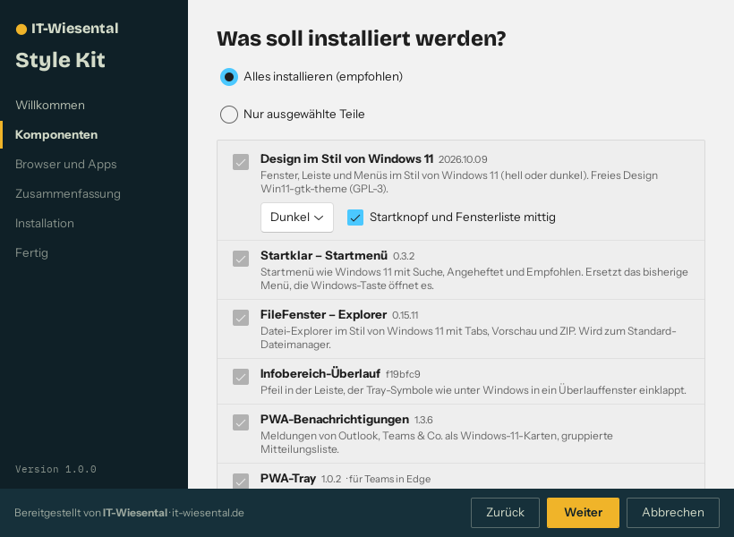
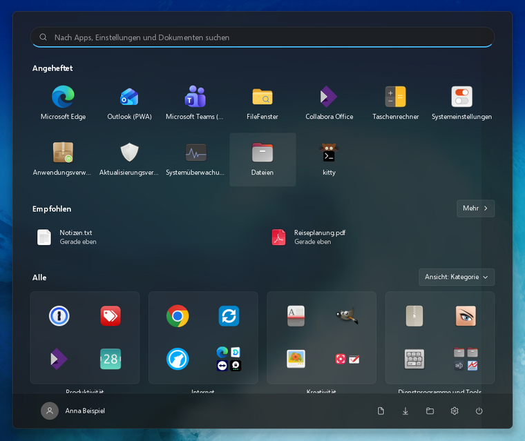
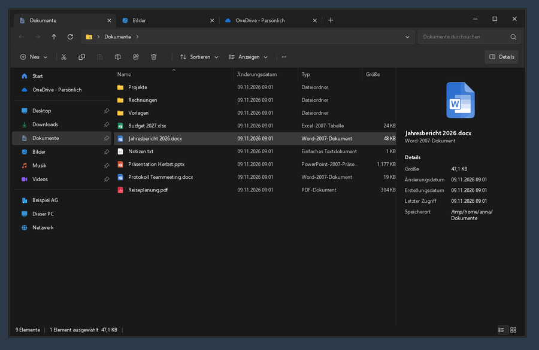
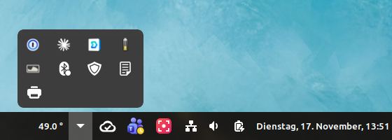
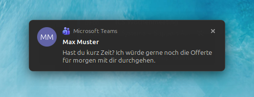
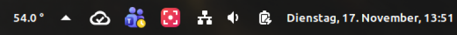
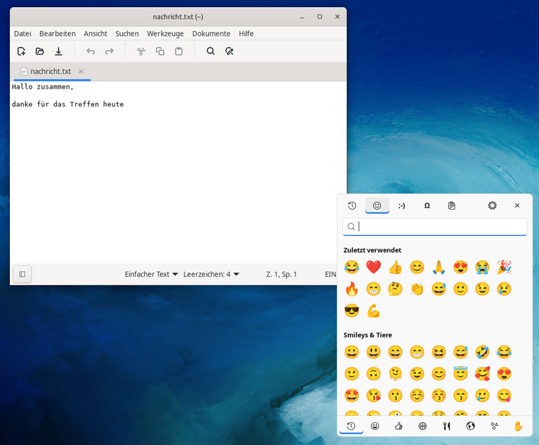
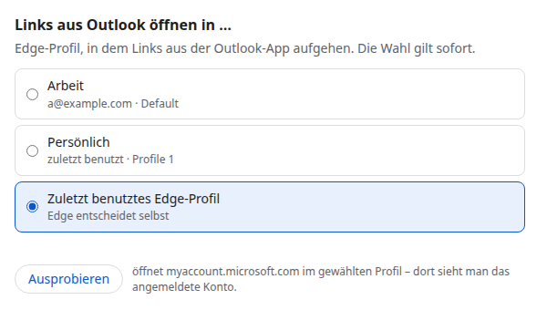
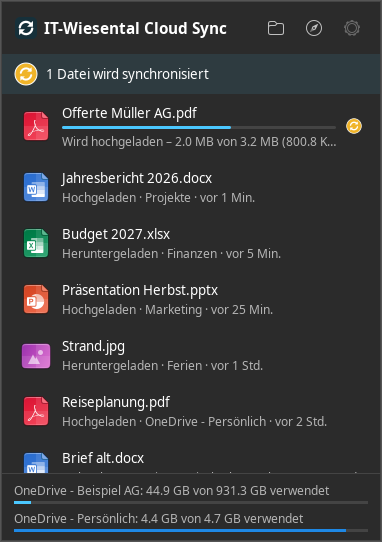
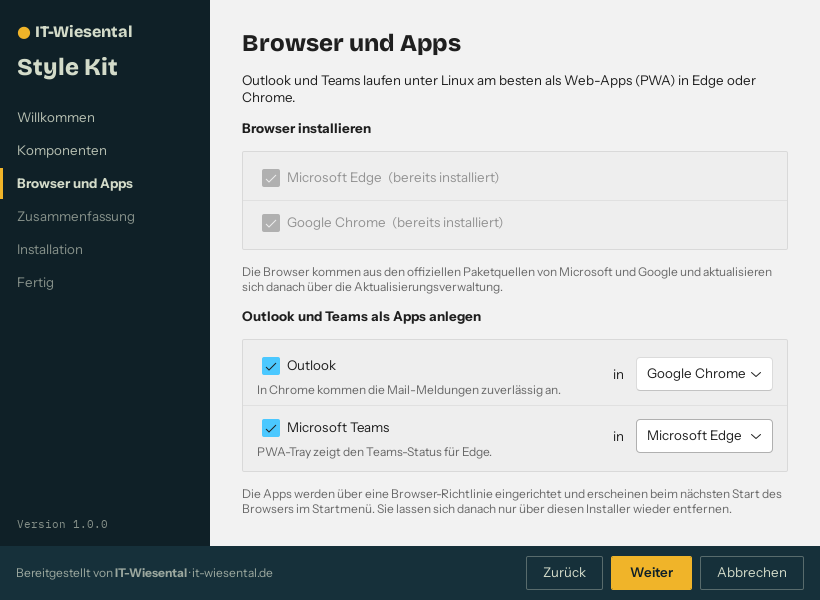

# IT-Wiesental Style Kit

**Linux Mint im Stil von Windows 11.** Komplettpaket von **IT-Wiesental** ([it-wiesental.de](https://it-wiesental.de)), das Linux Mint (Cinnamon)
im Stil von Windows 11 aussehen und arbeiten lässt. Ein Assistent installiert alle Werkzeuge auf einmal oder nur die
gewünschten Teile.



## Enthaltene Komponenten

| ID | Komponente | Was sie macht |
|----|------------|---------------|
| `design` | Design im Stil von Windows 11 | freies GTK-/Cinnamon-Design [Win11-gtk-theme](https://github.com/yeyushengfan258/Win11-gtk-theme) (hell oder dunkel), Startknopf und Fensterliste mittig |
| `startklar` | Startklar | Startmenü im Stil von Windows 11, Windows-Taste öffnet es |
| `filefenster` | FileFenster | Datei-Explorer im Stil von Windows 11, wird Standard-Dateimanager |
| `tray-collapse` | Infobereich-Überlauf | Tray-Symbole im Überlauffenster |
| `pwa-notifications` | PWA-Benachrichtigungen | Meldungen von Web-Apps als Karten im Stil von Windows 11 |
| `pwa-tray` | PWA-Tray | Teams schliesst ins Tray, mit Status und Zähler |
| `emoji-panel` | Emoji-Panel | Windows + . |
| `pwa-link-organizer` | PWA link organizer | Links aus Outlook (Chrome-App) öffnen in Microsoft Edge |
| `onedrive` | IT-Wiesental Cloud Sync | Synchronisierung mit Microsoft OneDrive/SharePoint, Dateien bei Bedarf |

IT-Wiesental Style Kit und alle enthaltenen Werkzeuge sind unabhängige Produkte, nicht von Microsoft
entwickelt, unterstützt oder mit Microsoft verbunden; «im Stil von Windows 11» beschreibt nur die Gestaltung. Microsoft, OneDrive, Teams,
Outlook und Edge sind Marken der Microsoft-Unternehmensgruppe; Chrome ist eine Marke von Google LLC.

## So sieht es aus

Die Bilder zeigen das dunkle Design. Namen und Dateien sind Beispiele.

### Startklar – Startmenü

Suche oben, angeheftete Apps, zuletzt benutzte Dateien und alle Apps nach Kategorie.
Die Windows-Taste öffnet es; ein Rechtsklick auf den Startknopf zeigt das Schnellmenü.



### FileFenster – Datei-Explorer

Tabs, Navigationsbereich mit Schnellzugriff und Cloud-Ordnern, Detailansicht und Detailbereich.



### Infobereich-Überlauf

Ein Pfeil in der Leiste klappt selten gebrauchte Tray-Symbole in ein kleines Fenster weg.



### PWA-Benachrichtigungen

Meldungen von Web-Apps wie Teams oder Outlook erscheinen als Karte mit App-Name,
Absenderbild und Text statt als «Microsoft Edge». Bei Teams-Anrufen gibt es Knöpfe zum
Annehmen, Annehmen mit Video und Ablehnen.



### PWA-Tray

Teams schliesst ins Tray statt sich zu beenden. Das Symbol zeigt Status und ungelesene Chats.



### Emoji-Panel

Windows + . öffnet das Emoji-Panel am Textcursor; ein Klick fügt das Emoji ein.
Dazu gibt es Kaomoji, Sonderzeichen und den Zwischenablage-Verlauf.



### PWA link organizer

Links aus der Outlook-App öffnen in Microsoft Edge, auf Wunsch in einem festen Edge-Profil.



### IT-Wiesental Cloud Sync

Ein Klick auf das Wolkensymbol in der Leiste zeigt, was gerade synchronisiert wird,
die letzten Änderungen und den belegten Speicher pro Konto.



## Browser und Web-Apps

Ist PWA-Benachrichtigungen, PWA-Tray oder PWA link organizer gewählt, bietet der Assistent an,
**Microsoft Edge** und **Google Chrome** zu installieren (offizielle Paketquellen von
Microsoft und Google, Updates danach über die Aktualisierungsverwaltung) und
**Outlook** und **Teams** als Apps anzulegen – empfohlen: Outlook in Chrome
(Mail-Meldungen kommen dort an), Teams in Edge (PWA-Tray).



Die Web-Apps werden über die Browser-Richtlinie `WebAppInstallForceList` in
`/etc/opt/edge/policies/managed/it-wiesental-style-kit.json` bzw.
`/etc/opt/chrome/policies/managed/it-wiesental-style-kit.json` eingerichtet. Sie erscheinen beim
nächsten Browserstart im Startmenü; vor der Anmeldung heissen sie wie im Assistenten.
Benutzer können sie nicht selbst deinstallieren – ein erneuter Installer-Lauf ohne Web-Apps
nimmt die Richtlinie wieder weg.

## Installation

Neueste Version herunterladen:
[it-wiesental-style-kit.tar.gz](https://github.com/Ikkarus13/it-wiesental-style-kit/releases/latest/download/it-wiesental-style-kit.tar.gz)
([Prüfsumme](https://github.com/Ikkarus13/it-wiesental-style-kit/releases/latest/download/it-wiesental-style-kit.tar.gz.sha256)),
entpacken, dann im entpackten Ordner:

```bash
./installieren.sh
```

Als normaler Benutzer starten (nicht mit sudo). Für Systempakete, Browser und Richtlinien
fragt der Assistent einmal nach dem Administrator-Passwort; alles andere landet in
`~/.local` des Benutzers. Protokoll: `~/.local/share/it-wiesental-style-kit/installation.log`.

### Textmodus (Verteilung, SSH)

```bash
./installieren.sh --alle --browser edge,chrome --webapps outlook=chrome,teams=edge
```

```bash
./installieren.sh --nur design,startklar,filefenster --design hell
```

`./installieren.sh --help` zeigt alle Optionen, `--liste` die Komponenten.

### Entfernen

Startmenü → **IT-Wiesental Style Kit** (Komponenten abwählen) oder
`~/.local/share/it-wiesental-style-kit/installer/main.py --entfernen ID,ID`.
Leiste, Design und Standard-Dateimanager werden dabei zurückgestellt.

## Hinweise

- Gebaut für Linux Mint 22 mit Cinnamon unter X11.
- Alle Programme sind fest im Paket enthalten und suchen nicht selbst nach Updates. Neue Versionen
  kommen mit einem neuen Paket: Das Kit prüft beim Anmelden, ob es eine gibt, und meldet sie.
  Aktualisiert wird über Startmenü → **IT-Wiesental Style Kit** → «Jetzt aktualisieren»
  (Design, Leiste und Browser bleiben dabei, wie sie sind).
- Die Browser-Erweiterungen von PWA-Tray und PWA link organizer müssen einmal von Hand geladen
  werden (der Assistent zeigt am Ende, wie).

## Unterstützen

Das Style Kit ist kostenlos. Wenn es dir gefällt:

- ⭐ Gib dem Projekt einen **Stern** hier auf GitHub (oben rechts) – das hilft anderen, es zu finden.
- ☕ **Unterstütze die Arbeit** per PayPal:
  [5 €](https://www.paypal.com/cgi-bin/webscr?cmd=_xclick&business=hallo%40it-wiesental.de&item_name=IT-Wiesental%20Style%20Kit%20unterst%C3%BCtzen&currency_code=EUR&no_shipping=1&amount=5) · [10 €](https://www.paypal.com/cgi-bin/webscr?cmd=_xclick&business=hallo%40it-wiesental.de&item_name=IT-Wiesental%20Style%20Kit%20unterst%C3%BCtzen&currency_code=EUR&no_shipping=1&amount=10) · [20 €](https://www.paypal.com/cgi-bin/webscr?cmd=_xclick&business=hallo%40it-wiesental.de&item_name=IT-Wiesental%20Style%20Kit%20unterst%C3%BCtzen&currency_code=EUR&no_shipping=1&amount=20) · [anderer Betrag](https://www.paypal.com/cgi-bin/webscr?cmd=_xclick&business=hallo%40it-wiesental.de&item_name=IT-Wiesental%20Style%20Kit%20unterst%C3%BCtzen&currency_code=EUR&no_shipping=1)

Der Assistent zeigt dieselben Möglichkeiten nach der Installation und erinnert einmalig zwei
Wochen später daran – danach nie wieder.

## Lizenz

**Freeware:** kostenlos nutzbar, privat und geschäftlich, aber nicht Open Source. Verändern,
verkaufen oder auf anderen Seiten zum Download anbieten ist nicht erlaubt. Details: [LICENSE](LICENSE).
Software Dritter (Design, Schriften, Symbole) steht unter eigenen Lizenzen: [DRITTANBIETER.md](DRITTANBIETER.md).

Für Entwickler: [docs/ENTWICKLUNG.md](docs/ENTWICKLUNG.md)
