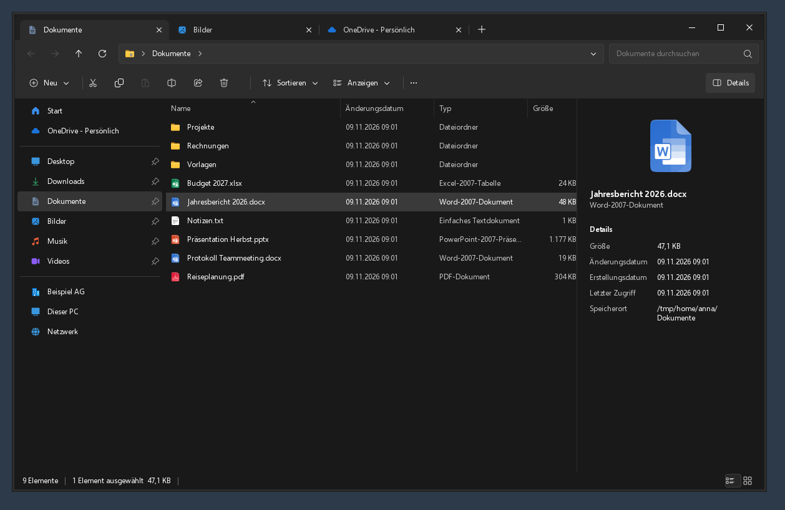
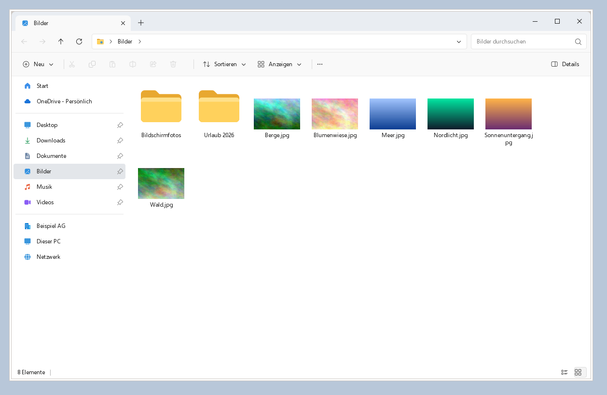
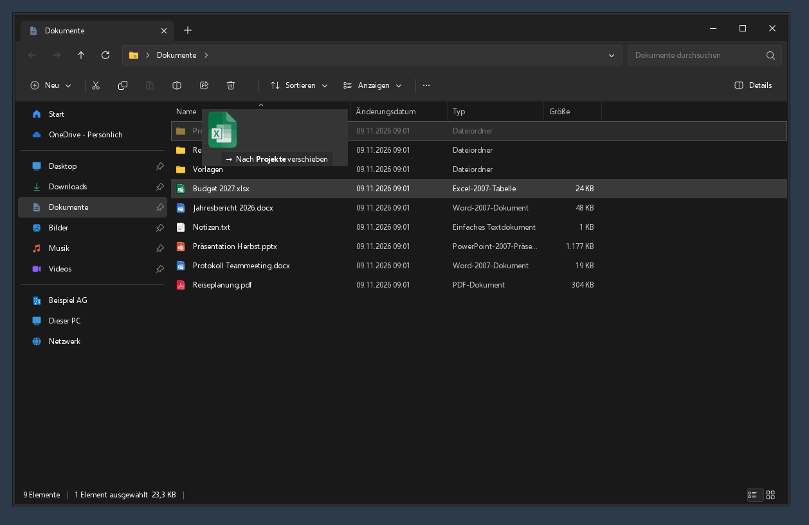
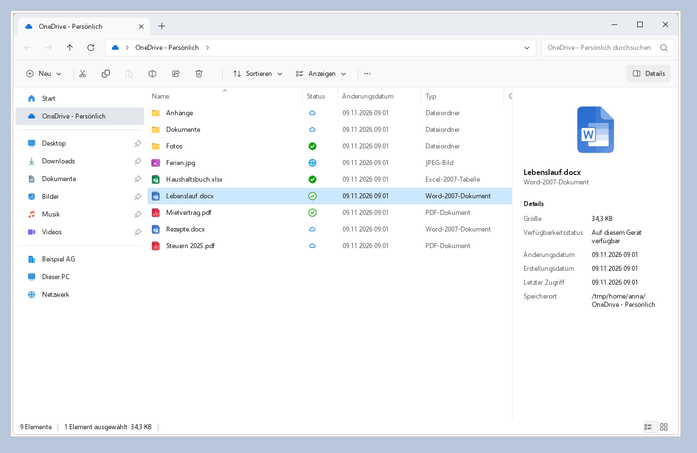

# FileFenster

Datei-Explorer für Linux (GTK3/Python) im Stil von Windows 11: Tabs in der
Titelleiste, Adressleiste mit Brotkrumen, Befehlsleiste, Navigationsbereich,
Start/Dieser PC, Ansichten wie unter Windows, Kontextmenüs im Stil von
Windows 11, helles und dunkles Design.





*(Die Bilder zeigen einen Demo-Benutzer mit erfundenen Dateien.)*

## Funktionen

- **Kopieren, Verschieben, Löschen** im Hintergrund mit Fortschrittsfenster wie
  unter Windows (Anhalten, Abbrechen, Mehr Details mit Geschwindigkeitskurve).
  Bei Namenskonflikten wird nach Ersetzen / Überspringen / Beide behalten
  gefragt. Wird das Fenster während eines Vorgangs geschlossen, läuft der
  Vorgang bis zum Ende weiter.
- **Tabs ziehen** im Stil von Windows 11: umsortieren, aus dem Fenster ziehen
  (neues Fenster) oder auf die Tab-Leiste eines anderen Fensters ziehen; der
  Verlauf (Zurück/Vor) wandert mit. Den einzigen Tab ziehen verschiebt das Fenster.
- **Vorschaufenster** (Alt+P, Detailbereich mit Alt+Umschalt+P): Bilder,
  Text- und Programmdateien, PDF (erste Seite), Video-Standbild, Audio mit
  Titel/Interpret/Länge, Office-Dateien über das Vorschaubild des Systems.
- **Katalog** (Galerie im Stil von Windows 11) im Navigationsbereich unter „Start“:
  alle Bilder und Videos der Sammlung (Standard: „Bilder“) nach Monaten,
  neueste zuerst (Aufnahmedatum aus EXIF, sonst Änderungsdatum), zoombar mit
  Strg+Mausrad; „Sammlung“ legt fest, welche Ordner dazugehören. Nur-online-
  Dateien von OneDrive werden dabei nicht heruntergeladen.
- **Spalten:** Rechtsklick auf den Spaltenkopf blendet Spalten ein und aus –
  Erstelldatum, Letzter Zugriff, Abmessungen, Länge, Autoren, Titel, unter
  „Weitere…“ auch Dateierweiterung und Besitzer; „Spaltenbreite anpassen“.
  Abmessungen, Länge, Autor und Titel kommen aus Bildern, Audio/Video,
  Office-Dateien und PDFs.
- **Suchoptionen** während einer Suche: Änderungsdatum, Art, Grösse und
  Dateiinhalte. Die Filter stehen wie unter Windows im Suchtext
  (`Art:Bild`, `Änderungsdatum:Heute`, `Grösse:Gross`) und lassen sich auch
  eintippen.
- **Ordneroptionen** (··· → Optionen): Startort (Start/Dieser PC), Ordner im
  selben oder eigenen Fenster, Öffnen mit einfachem Klick, Kontrollkästchen
  zur Auswahl, vollständiger Pfad in der Titelleiste, Statusleiste,
  Datenschutz (zuletzt verwendete Dateien, häufig verwendete Ordner, Verlauf
  löschen) und „Ordner zurücksetzen“.
- **Gruppieren nach** Änderungsdatum (Heute, Gestern, Letzte Woche …), Name,
  Typ oder Grösse – im Menü „Sortieren“ und im Rechtsklick-Menü, in allen
  Ansichten ausser „Liste“. Klick auf eine Gruppenüberschrift klappt sie ein.
  Die Einstellung gilt je Ordner; „Downloads“ ist wie unter Windows nach
  Datum gruppiert.
- **Rückgängig / Wiederholen** (Strg+Z / Strg+Y) für Umbenennen, Kopieren,
  Verschieben, Löschen und Neu.
- **Papierkorb** (··· → Papierkorb öffnen) mit Ursprünglicher Ort und
  Löschdatum, Wiederherstellen und Leeren.
- **Drag & Drop** auf Ordner in der Liste, in den Navigationsbereich
  (Verweilen klappt auf), auf die Adressleiste und auf Tabs (Verweilen wechselt
  den Tab), auch von und zu anderen Programmen. Gleiches Laufwerk verschiebt,
  anderes kopiert; Strg = kopieren, Umschalt = verschieben, Strg+Umschalt =
  Verknüpfung, Ziehen mit der rechten Maustaste fragt nach.

- **ZIP:** „In ZIP-Datei komprimieren“ im Kontextmenü (danach gleich
  umbenennen wie unter Windows) und „Alle extrahieren…“ mit Zielauswahl.
  Extrahieren kann ZIP und TAR (gz/bz2/xz), mit installiertem `7z` auch 7z
  und RAR. Pfade wie `../` im Archiv werden abgewiesen.
- **ZIP wie einen Ordner öffnen:** Doppelklick auf ein ZIP (auch TAR, 7z, RAR,
  CAB) zeigt den Inhalt wie einen Ordner, mit „Alle extrahieren“ in der
  Befehlsleiste. Dateien lassen sich öffnen und herauskopieren oder
  -ziehen. In ein ZIP kann man wie unter Windows auch schreiben: Dateien
  hineinziehen oder einfügen, löschen, umbenennen, neuer Ordner (andere
  Formate und ZIPs in Archiven bleiben schreibgeschützt). Nutzt den
  gvfs-Archivtreiber (`gvfsd-archive`, bei Linux Mint dabei).
- **USB-Sticks und andere Wechseldatenträger** erscheinen unter „Dieser PC“,
  sobald sie stecken – auch wenn der Desktop sie nicht von selbst einhängt.
  Ein Klick hängt sie ein (bei Verschlüsselung mit Passwortabfrage) und öffnet sie.
- **ISO/IMG bereitstellen:** Doppelklick oder „Bereitstellen“ hängt das
  Abbild schreibgeschützt als Laufwerk ein (über UDisks, ohne Passwort) und
  öffnet es. Auswerfen wie bei jedem Laufwerk unter „Dieser PC“.



## Netzwerk

- **Netzwerk** im Navigationsbereich zeigt gefundene Geräte (z. B. NAS,
  Windows-PCs); Doppelklick öffnet sie, bei Bedarf mit Anmeldung
  (Benutzer, Domäne, Passwort – auf Wunsch gemerkt).
- In die Adressleiste lässt sich wie unter Windows `\\server\freigabe`
  eingeben; die Adressleiste zeigt „Netzwerk › SERVER › freigabe“.
- **Netzlaufwerk verbinden** (··· bei „Dieser PC“/„Netzwerk“ oder Rechtsklick
  links): verbindet eine Freigabe und merkt sie sich auf Wunsch. Gemerkte
  Laufwerke stehen unter „Dieser PC“ → „Netzwerkadressen“, ein Klick verbindet
  erneut, „Trennen“ entfernt sie.
- Grundlage ist gvfs (bei Linux Mint dabei): SMB, SFTP, FTP und WebDAV.

## OneDrive, Teams und SharePoint

> **Voraussetzung:** Die OneDrive-Funktionen gibt es nur zusammen mit dem
> OneDrive-Client **onedrive-mint** („OneDrive für Linux“, eigenes Projekt
> von Ikkarus13, Repo `Ikkarus13/onedrive-linux`). FileFenster selbst
> synchronisiert nichts und spricht nicht mit Microsoft; es zeigt nur an, was
> onedrive-mint liefert. Ohne onedrive-mint funktioniert FileFenster ganz
> normal, nur ohne die Punkte in diesem Abschnitt.

Mit onedrive-mint zeigt FileFenster wie der Windows-Explorer:

- **Statussymbole** in der Spalte „Status“ (Detailansicht) bzw. unten links am
  Symbol (Symbolansichten): Wolke = nur online, Häkchen = auf diesem Gerät,
  grüner Kreis = immer auf diesem Gerät behalten, Pfeile = wird
  synchronisiert, rotes Kreuz = Fehler. Der Detailbereich nennt den
  Verfügbarkeitsstatus.
- **Kontextmenü** „Immer auf diesem Gerät beibehalten“, „Speicherplatz
  freigeben“ und „Online anzeigen“.
- **Teams-/SharePoint-Bibliotheken** unter dem Organisationsordner mit
  Gebäude-Symbol im Navigationsbereich, wie unter Windows direkt über
  „Dieser PC“.



## Installieren und Aktualisieren

`./installieren.sh` kopiert FileFenster nach `~/.local/share/filefenster`,
legt den Befehl `filefenster` und den Startmenü-Eintrag an und trägt es als
Standard-Dateimanager ein. Danach aktualisiert es sich selbst: einmal am Tag
sucht es im Hintergrund nach einer neuen Version (GitHub-Releases), von Hand
über „··· → Nach Updates suchen“. Ein Update wird nur mit gültiger Prüfsumme
installiert; die vorherige Version bleibt als Sicherung liegen.
`deinstallieren.sh` entfernt FileFenster wieder (Einstellungen bleiben, ausser
mit `--alles`).

## Starten

```bash
python3 filefenster.py [ORDNER | DATEI]
```

Bei einer Datei öffnet sich der Ordner mit der Datei ausgewählt.

Installieren (Startmenü-Eintrag, Befehl `filefenster`, Standard-Dateimanager):

```bash
./installieren.sh
```

Danach öffnen sich Ordner aus anderen Programmen in FileFenster, auch
„Im Ordner anzeigen“ aus Browser oder Downloads. Ordner-Doppelklicks auf dem
Desktop öffnet weiterhin Nemo, weil nemo-desktop den Desktop zeichnet.
`./installieren.sh --nicht-als-standard` installiert ohne Standard-Eintrag,
`./installieren.sh --nemo-als-standard` stellt Nemo wieder als Standard ein.

Bis Version 0.3.0 hiess das Programm „Durchblick“; die Einstellungen werden
beim ersten Start übernommen.

Voraussetzungen: Python 3, PyGObject mit GTK 3 (bei Linux Mint vorinstalliert).
Keine pip-Pakete.

## Tastenkürzel (im Stil von Windows)

| Taste | Funktion |
|---|---|
| Strg+T / Strg+W / Strg+Tab | Tab neu / schliessen / wechseln |
| Strg+N | Neues Fenster |
| Alt+← / Alt+→ / Alt+↑ / Rücktaste | Zurück / Vor / Nach oben / Zurück |
| Strg+L, Alt+D, F4 | Adressleiste |
| Strg+F, Strg+E, F3 | Suche |
| Strg+C / X / V, Entf, Umschalt+Entf | Kopieren / Ausschneiden / Einfügen / Papierkorb / endgültig löschen |
| Strg+Z / Strg+Y | Rückgängig / Wiederholen (Umbenennen, Kopieren, Verschieben, Löschen, Neu) |
| F2 | Umbenennen |
| Strg+Umschalt+N | Neuer Ordner |
| Strg+Umschalt+1 … 8 | Ansicht (Extra gross … Inhalt) |
| Strg+Mausrad, Strg+Plus/Minus | Symbolgrösse |
| Alt+Eingabe | Eigenschaften |
| Alt+P / Alt+Umschalt+P | Detailbereich |
| Strg+H | Ausgeblendete Elemente (Linux-Zusatz) |
| F5 | Aktualisieren |

## Lizenzen der Bestandteile

- Icons: [Fluent UI System Icons](https://github.com/microsoft/fluentui-system-icons), MIT-Lizenz
  (`assets/icons/fluent/LICENSE-FluentIcons.txt`)
- Schrift: [Selawik](https://github.com/microsoft/Selawik), SIL Open Font License 1.1
  (`assets/fonts/LICENSE-Selawik.txt`)
- Ordner-, Laufwerks- und Fenstersymbole: eigene Zeichnungen

Gesamtlizenz: siehe [LICENSE](LICENSE).

## Marken

Unabhängiges Projekt, nicht von Microsoft entwickelt, unterstützt oder mit
Microsoft verbunden. Microsoft und Windows sind Marken der
Microsoft-Unternehmensgruppe.

---

Für Entwickler: [docs/ENTWICKLUNG.md](docs/ENTWICKLUNG.md)
