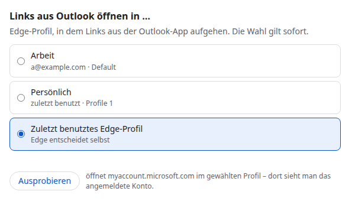

# PWA link organizer

Kleine Chrome-Erweiterung mit lokalem Helfer – ein unabhängiges Werkzeug, nicht von Microsoft oder Google.

Links, die man in der **Outlook-App in Google Chrome** anklickt (Mails, Kalender,
Teams-Besprechungslinks), gehen in **Microsoft Edge** auf statt in einem Chrome-Tab.

Hintergrund: Outlook läuft als Chrome-PWA, weil nur Chrome Outlooks Web-Push für
Desktop-Meldungen empfängt. Gesurft wird aber in Edge (Firmen-SSO); in Chrome
müsste man sich überall neu anmelden.


## So funktioniert es

```
Klick in Outlook ─▶ Outlook verarbeitet den Link selbst (Safe Links, Warnungen)
                 ─▶ Chrome legt einen Tab im Browserfenster an
                 ─▶ Erweiterung: Tab kommt aus Outlook, Ziel ist eine fremde
                    http(s)-Seite → Tab schliessen, URL an den Native-Host
                 ─▶ native-host/edge_links_host.py prüft die URL und startet
                    microsoft-edge --profile-directory=… <URL> (losgelöst)
```

Von Klick bis Edge vergehen rund 0,1 s. Hat Chrome kein normales Browserfenster
offen, blitzt dafür kurz eines auf und schliesst sich gleich wieder.

**Bleibt in Chrome** (wird nicht abgefangen):

- neue App-Fenster, z. B. eine Mail im eigenen Fenster (Pop-out, Doppelklick) –
  Links *in* diesem Mail-Fenster gehen aber wie in der Vorschau an Edge,
- Pop-up-Fenster, z. B. Anmeldung oder Add-in-Dialoge,
- Outlook-Adressen und Anhänge (`outlook.cloud.microsoft`, `outlook.office.com`,
  `outlook.office365.com`, `outlook.live.com`, `*.office.net`),
- die Microsoft-Anmeldung (`login.microsoftonline.com`, `login.microsoft.com`,
  `login.live.com`, …) und fremde Anmeldeseiten (ADFS, Okta …), wenn Outlook über
  die Microsoft-Anmeldung dorthin weiterleitet,
- Adressen, die man in einem solchen Outlook-Tab selbst eintippt (die Erweiterung
  beobachtet einen Tab nur, bis Outlooks Weiterleitungen durch sind),
- `mailto:`, `blob:`, Downloads, leere Fenster mit Inhalt aus Outlook (Drucken),
- Links aus anderen Seiten als Outlook.

Kann Edge nicht gestartet werden (Host fehlt, Edge meldet Fehler), öffnet die
Erweiterung den Link doch in Chrome – es geht nichts verloren.

## Einrichten

```bash
./install.sh
```

trägt den Native-Messaging-Host für Chrome ein
(`~/.config/google-chrome/NativeMessagingHosts/ch.sascha.edge_links.json`) und legt
`~/.config/edge-links/config.json` mit dem Edge-Profil an. Danach einmalig in Chrome:

1. `chrome://extensions` öffnen
2. oben rechts **Entwicklermodus** einschalten
3. **Entpackte Erweiterung laden** → den Ordner `extension/` dieses Projekts wählen

Die Erweiterungs-ID ist fest, deshalb passt der Host-Eintrag immer.

Wird der Projektordner verschoben: `./install.sh` erneut ausführen und die
Erweiterung in Chrome entfernen und neu laden.

## Einstellungen: Edge-Profil wählen

In welchem Edge-Profil die Links aufgehen, wählt man in den Einstellungen der
Erweiterung:

- `chrome://extensions` → «PWA link organizer» → **Details** → **Erweiterungsoptionen**, oder
- in einem normalen Chrome-Fenster: Puzzle-Symbol → «PWA link organizer» anklicken.



Die Liste kommt aus Edges `~/.config/microsoft-edge/Local State` (Name, Konto,
Profilordner). «Zuletzt benutztes Edge-Profil» überlässt die Wahl Edge.
**Ausprobieren** öffnet `myaccount.microsoft.com` im gewählten Profil – dort sieht
man, welches Konto angemeldet ist. Die Wahl gilt sofort und wird mit jedem Link an
den Host geschickt. Gibt es ein gewähltes Profil nicht mehr, entscheidet Edge.

Solange in der Erweiterung nichts gewählt ist, gilt `~/.config/edge-links/config.json`
(legt `install.sh` mit dem zuletzt benutzten Profil an):

```json
{ "profile": "Default" }
```

## Wenn ein Link doch in Chrome aufgeht

Unten in den Einstellungen steht unter **Letzte Entscheidungen**, was die
Erweiterung mit den letzten 50 neuen Tabs gemacht hat. Jeder Eintrag zeigt die Zeit,
nur den Hostnamen (keine Adressen) und den Grund, z. B. «an Edge übergeben»,
«Fenster «popup» – bleibt in Chrome» oder «Prüfung fehlgeschlagen». Fehlt zu einem
Klick in Outlook jeder Eintrag, hat Chrome der Erweiterung den neuen Tab gar nicht
gemeldet. **Protokoll leeren** löscht die Liste.

## Aktualisieren und entfernen

- Aktualisieren: `git pull`, dann in `chrome://extensions` bei «PWA link organizer» ↻
  (oder Chrome neu starten – entpackte Erweiterungen werden beim Start neu gelesen).
- Entfernen: `./install.sh --remove`, Erweiterung in `chrome://extensions` entfernen.

## Marken und Lizenz

Unabhängiges Projekt, nicht von Microsoft oder Google entwickelt, unterstützt oder mit ihnen verbunden.
Microsoft, Edge, Outlook und Teams sind Marken der Microsoft-Unternehmensgruppe; Chrome ist eine Marke
von Google LLC. Die Nennung beschreibt nur, womit das Werkzeug zusammenarbeitet. Lizenz: [LICENSE](LICENSE).

Für Entwickler: [docs/ENTWICKLUNG.md](docs/ENTWICKLUNG.md)
