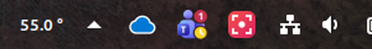
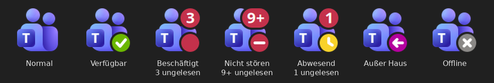
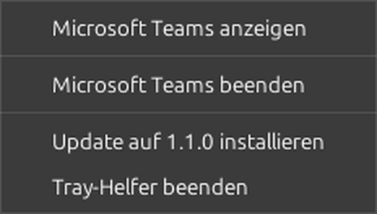

# PWA-Tray

**Microsoft Teams als PWA unter Linux Mint/Cinnamon – mit Tray-Verhalten im Stil von Windows 11.**

Der Schliessen-Knopf (✕) der Teams-PWA (Microsoft Edge) beendet Teams nicht mehr, sondern
legt es ins Tray. Teams bleibt verbunden: Anrufe, Chats und Meldungen kommen weiter an.
Das Tray-Symbol zeigt dabei im Stil von Windows 11 den eigenen Status und die Zahl ungelesener
Nachrichten.



## Was es kann

### ✕ legt Teams ins Tray

Fährt man über das ✕, wird es rot, im Stil von Windows 11. Ein Klick versteckt Teams aus der
Taskleiste und aus Alt+Tab, die Seite läuft im Hintergrund weiter.


### Status und Ungelesen-Zähler im Tray-Symbol

Unten rechts der eigene Teams-Status, oben rechts die Zahl ungelesener Chats und Aktivitäten
(ab 10 als „9+“). Der Tooltip sagt es auch in Worten, z. B. „Microsoft Teams – Abwesend · 1 ungelesen“.



### Bedienung

| Aktion | Wirkung |
|---|---|
| ✕ im Teams-Fenster | Teams verschwindet aus Taskleiste und Alt+Tab, läuft weiter |
| Strg+W im Teams-Fenster | dasselbe |
| Linksklick aufs Tray-Symbol | Teams zeigen bzw. wieder verstecken |
| Rechtsklick aufs Tray-Symbol | Menü (siehe Bild) |
| Meldung anklicken / Teams aus dem Startmenü | holt das Fenster normal zurück |
| Alt+F4 | beendet Teams weiterhin **wirklich** (Notausgang) |



Wird der Helfer über das Menü beendet, holt er versteckte Fenster vorher zurück.

### Updates

PWA-Tray sucht kurz nach dem Start und danach täglich auf GitHub nach einer neuen Version.
Gibt es eine, kommt eine Meldung, und im Rechtsklick-Menü steht **„Update auf X.Y.Z
installieren“**. Ein Klick lädt die neue Version (bei einem Git-Checkout per `git pull`),
startet den Helfer neu und lässt Teams dabei, wo es ist. Ohne Update steht dort
**„Nach Updates suchen“** für eine Prüfung von Hand.

Updates kommen über die GitHub-Releases. Optional verwendet der Helfer für die Abfrage ein
Token aus `update_token` in der Konfiguration oder, falls vorhanden, das der GitHub-CLI
(`gh auth token`).

## Installation

```bash
git clone https://github.com/Ikkarus13/pwa-tray.git ~/pwa-tray
cd ~/pwa-tray
./install.sh
```

`install.sh` legt den Autostart (`~/.config/autostart/pwa-tray.desktop`) an, registriert den
Native-Messaging-Host für Edge/Chrome und startet den Helfer.

Voraussetzungen: Linux Mint/Cinnamon unter X11, Python 3 mit `python3-xlib`, `python3-gi`,
`python3-cairo`, XApp (`gir1.2-xapp-1.0`), Microsoft Edge mit installierter Teams-PWA.

### Edge-Erweiterung für Status und Zähler (einmalig)

Edge gibt unter Linux kein App-Badge an das System weiter. Deshalb liest eine kleine
Erweiterung beides direkt in der Teams-Seite ab.

1. In Edge `edge://extensions` öffnen und den **Entwicklermodus** einschalten.
2. **Entpackte Erweiterung laden** → Ordner `edge-extension` aus diesem Repo wählen.

Die Erweiterung klinkt sich selbst in ein bereits offenes Teams-Fenster ein. Nach einem
Update, das die Erweiterung ändert, dort einmal **↻** (neu laden) drücken.

Es geht nichts ins Internet: Seite → Erweiterung → Native Messaging (`native_host.py`) →
D-Bus → PWA-Tray, alles lokal.

## Konfiguration

`~/.config/pwa-tray/config.json` (wird beim ersten Start angelegt):

| Schlüssel | Bedeutung |
|---|---|
| `apps` | Liste der PWAs: `name`, `wm_class` (= `StartupWMClass` aus der .desktop-Datei), `desktop` (Dateiname der .desktop-Datei). Weitere PWAs, z. B. Outlook, einfach ergänzen. |
| `button.width` / `button.height` | Fangbereich für das ✕ oben rechts in Pixeln (Standard 34×40) |
| `hover_color` | Farbe beim Darüberfahren (Standard `#c42b1c`) |
| `auto_update_check` | tägliche Update-Suche (`true`/`false`, Standard `true`) |
| `update_token` | GitHub-Token für die Update-Abfrage (optional, sonst `gh auth token`) |

## Entfernen

1. Im Rechtsklick-Menü **Tray-Helfer beenden** wählen (versteckte Fenster kommen dabei zurück).
2. Den Autostart-Eintrag `~/.config/autostart/pwa-tray.desktop` löschen.
3. Die Native-Messaging-Einträge `ch.sascha.pwa_tray.json` in
   `~/.config/microsoft-edge/NativeMessagingHosts/` bzw. `~/.config/google-chrome/NativeMessagingHosts/` löschen.
4. Die Erweiterung in `edge://extensions` entfernen.
5. Optional Konfiguration und Cache löschen: `~/.config/pwa-tray/`, `~/.cache/pwa-tray/`.

## Marken und Lizenz

Unabhängiges Projekt, nicht von Microsoft entwickelt, unterstützt oder mit Microsoft verbunden.
Microsoft, Windows, Edge, Outlook und Teams sind Marken der Microsoft-Unternehmensgruppe;
Chrome ist eine Marke von Google LLC. Die Nennung beschreibt nur, womit das Programm
zusammenarbeitet oder woran sich seine Gestaltung anlehnt. Lizenz: [LICENSE](LICENSE).

Für Entwickler: [docs/ENTWICKLUNG.md](docs/ENTWICKLUNG.md)
