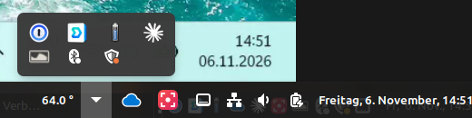

# Tray einklappen (Cinnamon-Applet)

Blendet die Tray-Symbole hinter einem kleinen Pfeil aus, im Stil von Windows 11.



## Funktionen

- **Linksklick auf den Pfeil (^):** öffnet ein Fenster über dem Panel mit den ausgeblendeten Symbolen.
  Ein Klick auf ein Symbol darin funktioniert wie im Panel. Linksklick schliesst das Fenster; bei Rechtsklick
  bleibt es offen, bis ein Menüpunkt ein Fenster öffnet oder daneben geklickt wird.
- **Cinnamon-Applets wie Wechseldatenträger und Drucker** werden ebenfalls ausgeblendet. Im Fenster erscheint ein
  Ersatzsymbol; ein Klick darauf zeigt das Applet kurz im Panel und öffnet sein Menü. Welche Applets das betrifft,
  lässt sich in den Einstellungen ändern (Liste mit Applet-UUIDs).
- **Rechtsklick → „Immer sichtbar“:** einzelne Symbole bzw. Applets bleiben direkt im Panel
- **Rechtsklick → Konfigurieren:**
  - Darstellung: Fenster über dem Panel (Standard) oder im Panel aus- und einklappen
  - Symbole pro Zeile im Fenster
  - automatisch wieder schliessen nach X Sekunden, Öffnen beim Überfahren mit der Maus

Das Applet ersetzt die Tray-Applets von Cinnamon nicht. Es hängt sich zur Laufzeit in
`xapp-status@cinnamon.org` und `systray@cinnamon.org` ein. Wenn es entfernt wird, ist alles wie vorher.

## Voraussetzungen

Getestet mit Cinnamon 6.6 (Linux Mint 22.3).

## Installation

```bash
./install.sh
```

Danach in **Systemeinstellungen → Applets** „Tray einklappen“ hinzufügen und im Panel-Bearbeitungsmodus
links neben die Tray-Symbole schieben.

## Marken und Lizenz

Unabhängiges Projekt, nicht von Microsoft entwickelt, unterstützt oder mit Microsoft verbunden.
Microsoft und Windows sind Marken der Microsoft-Unternehmensgruppe. Lizenz: [LICENSE](LICENSE).

Für Entwickler: [docs/ENTWICKLUNG.md](docs/ENTWICKLUNG.md)
